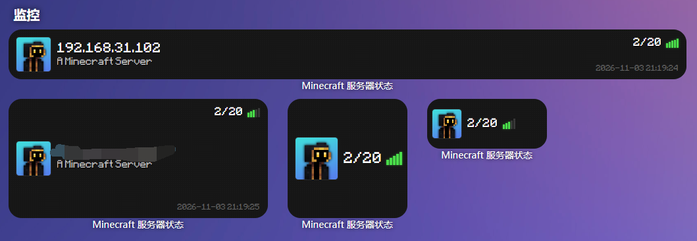

# Minecraft 服务器状态卡片 · Sun-Panel 微应用

在 Sun-Panel 桌面上放一张卡片，输入 Minecraft 服务器地址，就能看到和游戏内「多人游戏」列表一样的条目：服务器图标、MOTD、在线人数、延迟信号、查询时间。



支持四种卡片尺寸，信息量随尺寸自动调整：

| 尺寸 | 显示内容 |
|---|---|
| `1xfull`（整行） | 图标 + 地址 + MOTD + 人数 + 信号 + 查询时间 |
| `2x4` | 图标 + 地址 + MOTD + 人数 + 信号 |
| `2x2` | 图标 + 人数 + 信号 |
| `1x2` | 图标 + 人数 + 信号（紧凑） |

<p align="center">
  
</p>

---

## 特性

- **两种数据源**，按需选择
  - 公共 API（默认）：装完即用，零部署，查公网服务器
  - 本地桥接：支持局域网服务器（`192.168.x.x`），数据自己掌控
- **每张卡片独立绑定服务器**，可以同时盯多台
- **10 秒自动刷新**，间隔可在 10 秒 / 30 秒 / 1 分钟 / 2 分钟 / 5 分钟 / 关闭之间切换
- **SRV 记录解析**：`mc.example.com` 这种只配了 SRV 的服务器也能查
- **像素字体**：Mojangles（子集化 7 KB）+ Unifont 中文回退
- **文字自适应**：地址和 MOTD 会按实际宽度自动缩放字号，永远不截断
- **信号条**按真实延迟分级（<60ms 满格）

---

## 快速开始

### 1. 安装

把 `packages/cheering-MCServer-Status-*.zip` 传到 Sun-Panel 的微应用管理页安装。

### 2. 添加卡片

桌面上添加「Minecraft 服务器状态」卡片，直接在卡片上输入地址：

```
play.example.com:25565
```

回车即可。默认走公共 API，**不需要部署任何东西**。

### 3. （可选）配置

进卡片配置页可以调整：

- **数据源**：公共 API / 桥接服务
- **自动刷新**：10 秒 ~ 5 分钟，或关闭
- **部署包下载**：需要查局域网时用

---

## 两种数据源怎么选

| | 公共 API（默认） | 本地桥接 |
|---|---|---|
| 部署成本 | 零 | 下载 + 一条命令 |
| 公网服务器 | ✅ | ✅ |
| 局域网服务器 | ❌ | ✅ |
| 延迟数据 | 无（信号条恒满） | 真实延迟 |
| 稳定性 | 取决于第三方 | 自己可控 |

---

## 为什么局域网需要桥接服务

Sun-Panel 微应用运行在**浏览器**里，只能发 HTTP 请求。
而 Minecraft 服务器列表查询用的是 **TCP 上的自定义协议**（Server List Ping）。

浏览器沙箱不提供原始 TCP socket 能力，所以必须有一个跑在浏览器之外的服务做翻译：

```
Sun-Panel 微应用
      │  GET /status?host=1.2.3.4&port=25565   (HTTP)
      ▼
  桥接服务 bridge.py
      │  Server List Ping                      (TCP)
      ▼
  Minecraft 服务器
```

桥接服务单文件、零依赖、只用 Python 标准库。

---

## 部署桥接服务

配置页里点「下载部署包」拿 `bridge.zip`，解压后按平台选一种：

### Linux / NAS

```bash
sudo bash bridge/install.sh          # 默认 8848
sudo bash bridge/install.sh 9000     # 自定义端口
sudo bash bridge/install.sh --uninstall
```

自动注册 systemd 服务、开机自启、打印出该填的地址。

### Docker

```bash
cd bridge
docker compose up -d
```

### Windows

```powershell
cd bridge
powershell -ExecutionPolicy Bypass -File start.ps1
```

首次运行会生成 `start-hide.vbs`，之后双击即可后台无窗口运行。

### 裸跑

```bash
python3 bridge/bridge.py --port 8848
```

部署完成后，配置页把数据源切成「桥接服务」，地址填 `http://<那台机器的IP>:8848`，点「测试连接」。

> 配置页的地址默认按浏览器地址栏的 host 自动推断（`http://<你访问 Sun-Panel 的地址>:8848`），桥接和 Sun-Panel 同机时通常直接可用。

---

## 地址写法

| 写法 | 行为 |
|---|---|
| `192.168.1.100:25565` | 直连指定端口 |
| `192.168.1.100` | 直连默认 25565 |
| `play.example.com:25570` | 直连指定端口（FRP / 端口转发） |
| `mc.example.com` | **先查 SRV 记录**，找不到再用 25565 |

最后一条很重要：很多公网服务器只配了 `_minecraft._tcp` 的 SRV 记录，A 记录并不指向真正开放的 MC 端口。桥接服务会用 `dig` 查 SRV 再连。

---

## 桥接服务接口

### `GET /health`

```json
{ "ok": true, "version": "1.0.0", "service": "mcserver-bridge" }
```

### `GET /status?host=<host>&port=<port>`

成功：

```json
{
  "ok": true,
  "host": "192.168.1.100",
  "port": 25565,
  "online": true,
  "version": "1.21.1",
  "protocol": 767,
  "players": { "online": 2, "max": 20, "sample": [] },
  "motd": "A Minecraft Server",
  "motdText": "A Minecraft Server",
  "favicon": "data:image/png;base64,...",
  "latency": 12,
  "srv": "",
  "queriedAt": "2026-11-03T21:18:54+08:00"
}
```

失败时 `ok: false`，`error` 会给出具体原因（域名解析失败 / 连接超时 / 端口拒绝连接 / 对端提前断开 / 返回非 JSON 等）。

### 参数

| 参数 | 默认 | 说明 |
|---|---|---|
| `--host` | `0.0.0.0` | 监听地址 |
| `--port` | `8848` | 监听端口 |
| `--timeout` | `5.0` | SLP 查询超时（秒） |
| `--cache` | `3.0` | 相同地址结果缓存秒数，`0` 关闭 |
| `--retry` | `1` | 失败重试次数 |

---

## 常见问题

### 卡片显示"查询失败"

| 现象 | 原因 | 处理 |
|---|---|---|
| `请求公共 API 失败` | 无法访问 api.mcstatus.io | 换桥接服务 |
| `公共 API 查不到内网地址` | 第三方进不了你的局域网 | 部署桥接服务 |
| `No permission to access` | 微应用白名单没放行 | 见下方「网络白名单」 |
| `域名解析失败` | 域名拼错 / DNS 不通 | `getent hosts <域名>` |
| `连接超时` | 端口不通 / FRP 掉线 | `timeout 5 bash -c '</dev/tcp/host/port'` |
| `端口拒绝连接` | 服务没在该端口监听 | 检查 `server-port` |

最快的验证方式是直接打桥接服务：

```bash
curl 'http://127.0.0.1:8848/status?host=192.168.1.100&port=25565'
```

### 网络白名单

`networkDomains` 是**打包期**写死的（Sun-Panel 不提供运行时修改接口）。默认放开所有域名（`'*'`），所以任何人都能直接用。

想收紧的话，构建时指定：

```bash
# Windows
set MCS_BRIDGE=192.168.1.50,192.168.1.50:8848
npm run pack
```

> Sun-Panel 精确匹配 URL 里的 host：带端口时 `IP` 和 `IP:端口` 两种写法都要列，否则会报 `No permission to access: http://<host>:<port>/status`。

---

## 开发

```bash
npm install
npm run dev     # 在线调试
npm run build   # 构建
npm run pack    # 构建并打包成可安装的 zip
```

产物在 `packages/` 目录。

### 目录结构

```
.
├── bridge/                    # 桥接服务（Python 标准库，单文件）
│   ├── bridge.py
│   ├── Dockerfile
│   ├── docker-compose.yml
│   ├── install.sh             # Linux 一键安装
│   └── start.ps1              # Windows 启动脚本
├── config/
│   ├── app.config.js
│   └── components.config.js
├── docs/                      # 图标与截图
├── locales/
│   ├── zh-CN.js
│   └── en-US.js
├── src/
│   ├── api/bridge.js          # 请求封装 + 配置存取 + 数据源
│   ├── components/
│   │   ├── card.js            # 卡片组件（三档布局）
│   │   └── config.js          # 配置页
│   ├── styles/fonts.js        # 像素字体注入
│   └── main.js                # 入口
├── tools/
│   └── slp_test.py            # SLP 协议独立测试
└── package.json
```

### 三档布局

`card.js` 按平台给的 `gridSize` 分档：

```javascript
_tier() {
  if (size === '1x2')  return 'mini';    // 图标 + 人数 + 信号
  if (size === '2x2')  return 'square';  // 同上，图标更大
  return 'full';                          // 1xfull / 2x4，带地址和 MOTD
}
```

### 文字自适应

`full` 档渲染后会测量文本自然宽度，超出容器就按比例缩字号：

```javascript
_fitText() {
  el.style.fontSize = '';                    // 复位到 CSS 基准值
  const avail = el.clientWidth;
  const need = el.scrollWidth;
  if (need > avail) {
    const base = parseFloat(getComputedStyle(el).fontSize);
    el.style.fontSize = (base * (avail / need) * 0.985) + 'px';
  }
}
```

触发时机：数据变化后、`ResizeObserver` 检测到尺寸变化、`document.fonts.ready`（像素字体异步加载完字宽会变）。

---

## 致谢

卡片视觉参考 [astrbot_plugin_just_enough_mcserver_status](https://github.com/NightVoyager14/astrbot_plugin_just_enough_mcserver_status) 的服务器列表样式。

## License

MIT
